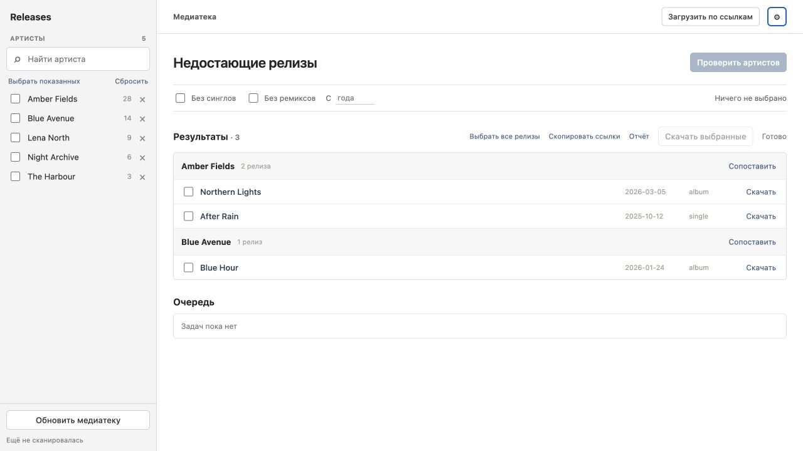
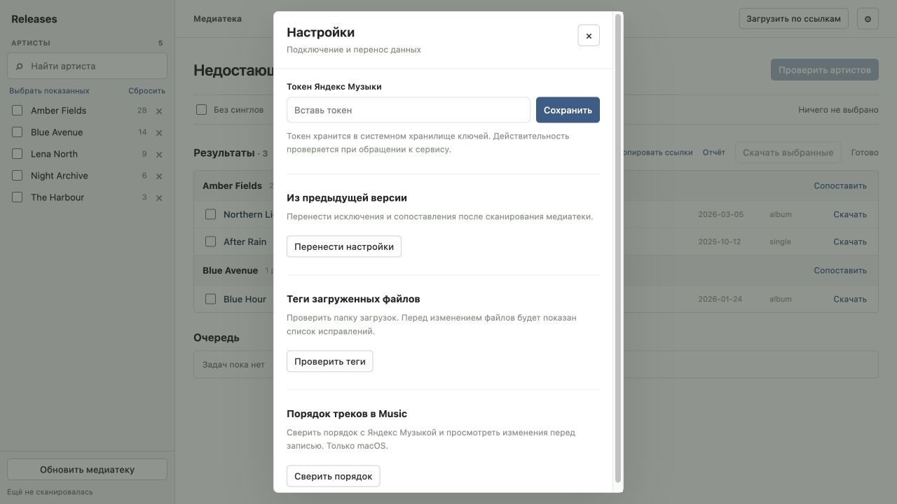

# Releases

Локальный сервис для поиска релизов артистов из музыкальной медиатеки. Он сравнивает индекс аудиофайлов с каталогом Яндекс Музыки и помогает загрузить выбранные альбомы.

- Индексация медиатеки с повторным использованием неизменённых файлов.
- Выбор артистов, фильтры, исключения и ручное сопоставление.
- Проверка в фоне, сохранение результатов и кэш дискографий.
- Очередь загрузок по результатам и по списку ссылок; существующие файлы не перезаписываются.
- Экспериментальное добавление загруженных файлов через приложение Music на macOS с сохранением исходников.
- Токен в системном хранилище ключей macOS или Windows через `keyring`.
- Экспорт Markdown и предварительный просмотр исправлений тегов и порядка треков.

## Интерфейс

На снимках использованы вымышленные артисты и релизы.





## Установка и запуск

Нужны Python 3.10+ и [uv](https://docs.astral.sh/uv/getting-started/installation/). На macOS с zsh или bash:

```sh
./scripts/install.sh
```

Откройте новое окно терминала и запустите `releases`. Установщик сохраняет резервную копию `.zshrc` или `.bashrc`. Можно запустить и без установки:

```sh
uv run python -m releases
```

По умолчанию приложение открывает локальный адрес `http://127.0.0.1:8771`. Аргументы `--library`, `--downloads`, `--data-dir` и `--port` позволяют изменить пути и порт. [Сценарии использования](docs/usage.md) описывают первый запуск и основные действия.

## Проверка

```sh
uv run python -m unittest discover -s tests -v
```

Поиск и сравнение не гарантируют полного совпадения каталогов. Полная загрузка зависит от доступа аккаунта. Интеграция с реальным приложением Music и работа на Windows пока не проверены; импорт в Music доступен только на macOS. При неопределённом результате импорта проверьте медиатеку вручную перед повтором. Исправление тегов проверено на тестовых файлах; сверка порядка и импорт в Music на реальной медиатеке пока не проверены.
